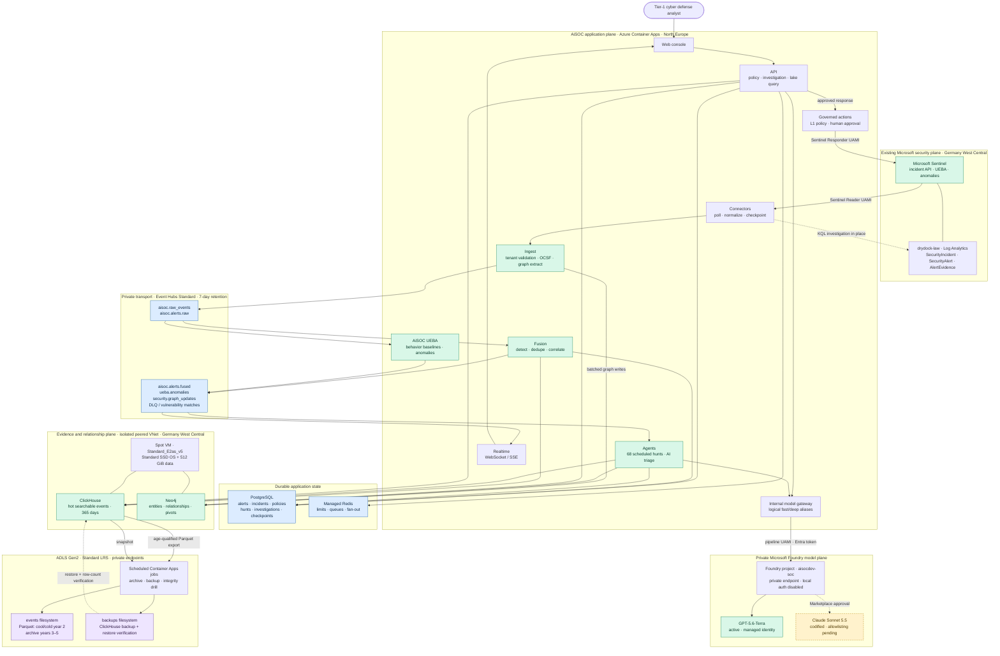

# AiSOC Azure architecture

This is the deployed proof-of-concept in subscription `dev-defconai`. The
existing `drydock-dev/drydock-law` workspace remains the Microsoft Sentinel
system of record. AiSOC reads Sentinel incidents and selected Log Analytics
tables in place; it does not export the workspace into Event Hubs.

## Managed-identity boundaries

| Identity | Workloads | Azure data-plane roles |
| --- | --- | --- |
| `aisocdev-runtime` | API, web | ACR pull, Key Vault secret read, ADLS read for application queries |
| `aisocdev-pipeline` | ingest, fusion, UEBA, agents, realtime, model gateway, archive and backup jobs | ACR pull, Key Vault secret read, Event Hubs Data Sender/Receiver, Cognitive Services User, ADLS contribution |
| `aisocdev-connectors` | connector scheduler | ACR pull, Key Vault secret read, Microsoft Sentinel Reader on `drydock-dev` |
| `aisocdev-actions` | governed actions | ACR pull, Key Vault secret read, Microsoft Sentinel Responder on `drydock-dev` |

Four identities are the lean trust-boundary result, not one identity per
service. Runtime and pipeline workloads share permissions inside their planes;
Sentinel read and writeback stay separate so a connector compromise does not
gain incident-management authority. The ClickHouse/Neo4j VM uses its own
system-assigned identity only for its ADLS backup boundary.

## Ingestion and health semantics

1. The managed-identity connector polls the Sentinel incident API and queries
   `drydock-law` only when an investigation needs table evidence.
2. Ingest validates the tenant and publishes through the Kafka-compatible
   Event Hubs endpoint with the pipeline identity. Each writer has an isolated
   transport pool so concurrent raw, vulnerability, and graph publishing
   cannot corrupt Kafka correlation IDs.
3. Fusion promotes security findings, runs detections, correlates alerts, and
   persists both PostgreSQL state and ClickHouse raw-event projections. Ingest
   also writes extracted entities and relationships to Neo4j.
4. Azure Container Apps calls ingest `/readyz` every 60 seconds. That endpoint
   actively checks the managed-identity Event Hubs/Kafka publisher; `/livez`
   remains process-only so a broker outage does not create a restart loop. The
   API shares the same readiness result with the dashboard on a 60-second cache.
   Recent persisted flow and scheduled-connector freshness remain fallbacks for
   self-hosted deployments without the probe. Stale connectors still appear in
   backlog/error detail and on the connector-health page.

The LAW is not required to forward any tables to Event Hubs for this design.
Event Hubs is AiSOC's internal seven-day recovery buffer, not its evidence
archive and not a duplicate of Sentinel storage.

## Retention and recovery

- ClickHouse is the hot searchable tier. Tenant policy defaults raw-event
  retention to 365 days; its table TTL has a 400-day safety ceiling so the
  archive job has time to export before deletion.
- Parquet is written to the private ADLS Gen2 `events` filesystem when records
  age out of the hot window. Blobs are cool immediately, cold after 90 days,
  archived after one year, and deleted after four ADLS years. Combined with
  the ClickHouse year, that is five years end to end: one hot, one cool/cold,
  and three archived.
- The backup job writes to the separate `backups` filesystem, downloads its
  own artifact, validates the checksum, restores it into a temporary table,
  and compares row counts. The Spot VM may be evicted; these jobs and ADLS are
  the recovery mechanism, not a claim of high availability.

## Models and governed response

The API and agents call gateway aliases and hold no provider API keys. The
gateway obtains a Foundry token with the pipeline UAMI over private networking.
GPT-5.6-Terra currently serves both aliases. Claude Sonnet 5.5 is declared but
disabled because Azure returned `MarketplaceSubscriptionCannotBeCompleted` for
this subscription; enabling it remains a provider-side allowlisting action.

Actions run at maturity tier L1. Policies are enabled, but destructive or
high-impact response stays approval-gated. The deployment does not silently
raise autonomy merely because the pipeline and AI model are operational.
