# AiSOC Azure architecture

This diagram describes the deployed test stack in subscription `dev-defconai`.
The existing `drydock-dev/drydock-law` workspace remains the Microsoft Sentinel
system of record. AiSOC polls Sentinel incidents in place; it does not export
Log Analytics tables into Event Hubs.

```mermaid
flowchart LR
  analyst["SOC analyst"]

  subgraph sentinel["Existing security operations plane"]
    law["drydock-law\nSecurityIncident · SecurityAlert · AlertEvidence"]
    incidents["Microsoft Sentinel\nincident API"]
    law --- incidents
  end

  subgraph apps["AiSOC · Azure Container Apps"]
    direction LR
    web["Web console"]
    api["API"]
    connector["Sentinel connector\npoll + normalize + checkpoint"]
    ingest["Ingest\ntenant validation + publish"]
    fusion["Fusion\nOCSF normalize + dedupe + correlate"]
    agents["Agents\ntriage + investigation"]
    realtime["Realtime\nWS / SSE fan-out"]
    actions["Governed actions\napproval + writeback"]
    gateway["Internal model gateway\nOpenAI-compatible aliases"]
  end

  subgraph transport["Private event transport"]
    direction LR
    ehraw["Event Hubs Standard\naisoc.raw_events / aisoc.alerts.raw"]
    ehfused["Event Hubs Standard\naisoc.alerts.fused / graph updates"]
  end

  subgraph state["Durable application state"]
    direction LR
    postgres["PostgreSQL\nalerts · incidents · connectors\ninvestigations · checkpoints"]
    redis["Managed Redis\nqueues · limits · fan-out"]
  end

  subgraph ai["Private managed-identity model plane"]
    direction LR
    pe["Private endpoint + DNS"]
    foundry["Microsoft Foundry\naisocdev-soc"]
    gpt["GPT-5.6-Terra\nactive"]
    claude["Claude Sonnet 5.5\ncodified · subscription allowlist pending"]
  end

  subgraph platform["Deployment and secrets"]
    direction LR
    acr["Azure Container Registry\nimmutable image digests"]
    kv["Key Vault\nruntime secrets + internal gateway key"]
    terraform["Terraform\nnetwork · RBAC · services"]
  end

  analyst --> web
  web --> api
  realtime --> web
  api --> postgres
  api --> redis

  incidents -->|"poll with Sentinel Reader"| connector
  connector -->|"normalized accepted events"| ingest
  connector -. "optional investigation queries" .-> law
  ingest --> ehraw
  ehraw --> fusion
  fusion --> postgres
  fusion --> ehfused
  ehfused --> agents
  ehfused --> realtime
  agents --> postgres
  agents --> redis
  api -->|"approved response request"| actions
  actions -->|"Sentinel Responder writeback"| incidents

  api --> gateway
  agents --> gateway
  gateway -->|"pipeline UAMI · Entra token"| pe
  pe --> foundry
  foundry --> gpt
  foundry -.-> claude

  terraform --> acr
  terraform --> kv
  terraform -. "provisions private services" .-> ehraw
  terraform -.-> foundry
  acr -. "immutable images · AcrPull" .-> web
  kv -. "secret references · Key Vault Secrets User" .-> api

  classDef active fill:#d9f7e8,stroke:#16845b,color:#0b3b2b;
  classDef waiting fill:#fff2cc,stroke:#b78103,color:#4d3800,stroke-dasharray:5 3;
  class gpt active;
  class claude waiting;
```

## Managed-identity boundaries

| Identity | Workloads | Azure data-plane roles |
| --- | --- | --- |
| `aisocdev-runtime` | API, web | ACR pull, Key Vault secret read |
| `aisocdev-pipeline` | ingest, fusion, agents, realtime, model gateway | ACR pull, Key Vault secret read, Event Hubs Data Sender/Receiver, Cognitive Services User |
| `aisocdev-connectors` | connector scheduler | ACR pull, Key Vault secret read, Microsoft Sentinel Reader on `drydock-dev` |
| `aisocdev-actions` | governed actions | ACR pull, Key Vault secret read, Microsoft Sentinel Responder on `drydock-dev` |

This is intentionally four identities rather than one per service. Runtime and
pipeline permissions are consolidated where the workloads share a trust
boundary, while Sentinel read and writeback remain separate because a connector
compromise must not gain incident-management authority.

## Ingestion and retention semantics

1. The connector polls the Sentinel incident API every five minutes and keeps a
   Sentinel last-modified checkpoint.
2. Ingest validates the declared tenant and publishes accepted events to the
   private Event Hubs namespace with managed identity.
3. Fusion normalizes, deduplicates, correlates, and persists durable alerts in
   PostgreSQL. Agents triage fused alerts and also persist their results there.
4. The connector stores both a cumulative `events_ingested` counter and the
   freshest accepted source time in `last_event_at`. The Operations Funnel uses
   the latter to decide whether Ingest is fresh.

Event Hubs is a one-day transport buffer in this test stack. A raw-event
ClickHouse lake is not deployed, so Event Hubs should not be treated as the
long-term evidence archive. Sentinel/Log Analytics retains the original Azure
security evidence, while PostgreSQL retains AiSOC alerts, incidents, connector
state, and investigation records.

## Model routing state

The API and agents use logical gateway aliases; they do not hold provider API
keys. The internal gateway uses the pipeline identity to obtain a Foundry token
through private networking. GPT-5.6-Terra currently serves both the fast and
deep aliases. When the subscription is enabled for the Claude Marketplace
offer and `enable_claude_sonnet` is set, the deep aliases switch to Claude
Sonnet 5.5 without changing the callers.
